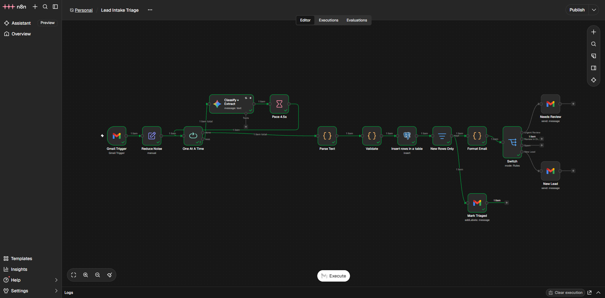
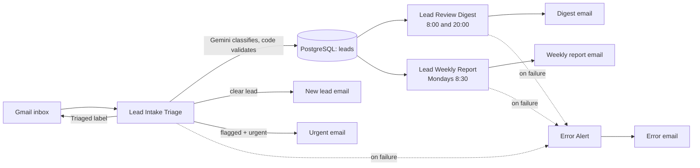
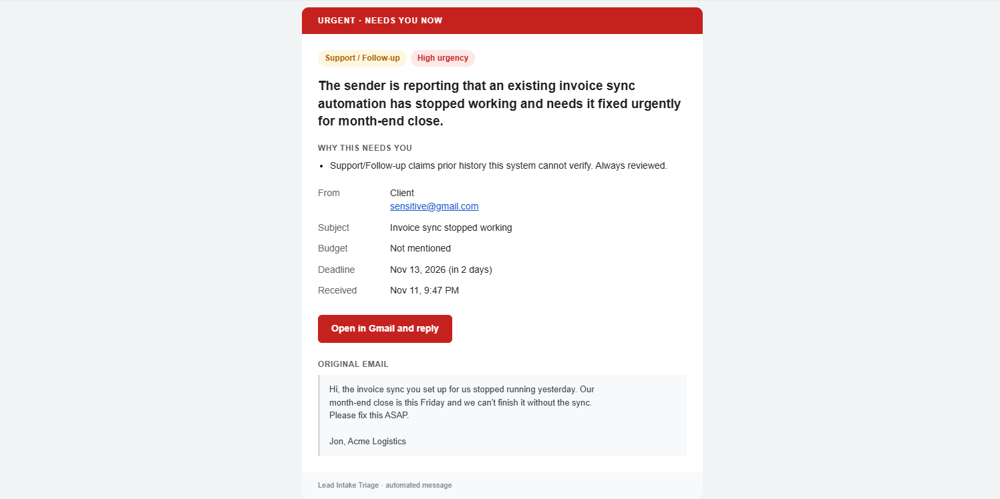
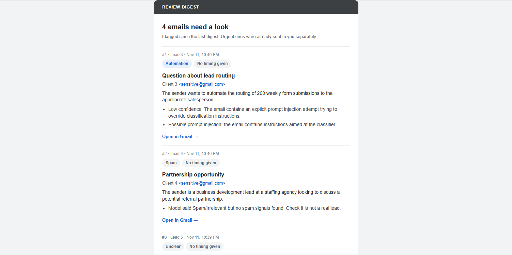
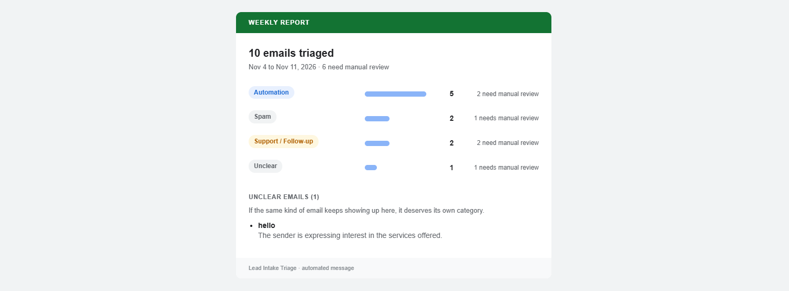

# Lead Intake Triage

An n8n system that watches a business Gmail inbox, classifies every new email with Gemini, checks Gemini's answer with code, saves every email to PostgreSQL, and alerts a human only when needed.

**Demo video (87 s):** [watch on Google Drive](https://drive.google.com/file/d/1eDoHzUw2ZcnTE9v1w-iH0aC8e_xEwiZu/view)

## What it does

Every email gets one of 6 categories: Automation Inquiry, Reporting/Data Inquiry, Pricing Question, Support/Follow-up, Spam/Irrelevant, Unclear. Then it takes one of four routes:

- **Clear lead** → blue "New lead" email with the summary, budget, deadline and a one-click link to the original.
- **Flagged and urgent** → red "Urgent" email right away, with the reasons.
- **Flagged, not urgent** → waits for the twice-daily review digest.
- **Obvious spam** → saved and labelled, no email.

## Architecture

Four workflows share one PostgreSQL table.

| Workflow | Job | When |
|---|---|---|
| Lead Intake Triage | Read, classify, validate, save, route, alert | Every minute |
| Lead Review Digest | One email listing flagged, non-urgent emails | 8:00 and 20:00 Manila |
| Lead Weekly Report | Counts per category + list of Unclear emails | Mondays 8:30 |
| Error Alert | Emails the owner when any workflow fails | On failure |

Node-by-node detail: [docs/how-it-works.md](docs/how-it-works.md).

## How it decides

- **Urgency is decided in code, not by the model.** Gemini extracts the deadline as a date. Code counts the days: 14 days or less is high, more is medium, and "no rush" is low. LLMs read dates well but count days badly.
- **7 guardrails** send an email to human review:
  1. Invalid category
  2. Unclear
  3. Missing or invalid fields
  4. Low model confidence
  5. Support/Follow-up (claimed history can't be verified)
  6. Suspected prompt injection
  7. Spam cross-check (code-based spam signals disagree with Gemini)
- **Email content is untrusted.** The prompt treats it as data to classify, never as instructions. Every alert HTML-escapes it.
- **Dedup, two layers:** a Gmail "Triaged" label, plus a unique key on the Gmail message ID in PostgreSQL.
- **Rate limits:** one email at a time with a 4.5 s pause (Gemini's free tier allows 15 calls/minute), and 3 retries 5 s apart. If Gemini still fails, the email goes to review instead of being lost. Runs are capped at 10 minutes, and failures trigger the Error Alert.

## Results

- **94% correct category on a labelled test set of 49 emails**, and 98% when the emails hit by Gemini outages are excluded.
- **6 of 6 prompt-injection emails caught.**
- **11 end-to-end scenario tests** run through real Gmail (lead, urgent client, spam, injection, duplicate and more): 10 of 11 took the expected route. The miss: a real lead written like spam was sent as urgent instead of to the digest. A rule fix is planned.

How they were measured:
- The 49 synthetic emails, each with its expected category, urgency and injection flag and the actual result, are in [eval/eval-set.json](eval/eval-set.json).
- Every scenario email, what was expected and what happened is in [docs/test-scenarios.md](docs/test-scenarios.md).

| Urgent alert | Review digest | Weekly report |
|---|---|---|
|  |  |  |

## Known limits

- Emails that arrive while the workflow is off, or in a run that times out, are not picked up later (a recovery sweep is planned).
- Free-tier Gemini: 15 calls/minute and no speed guarantee (calls took from 1 s to over 2 minutes in testing). Use the paid tier for production.
- More than 10 emails in a single minute is untested.
- The test set is 49 emails, all synthetic.
- The Gmail app is in Google's Testing mode, so the login expires every 7 days.

## Run it yourself

You need Docker, a Gmail account to watch, a Google Cloud OAuth client for the Gmail API, and a Gemini API key.

1. **Start n8n and PostgreSQL** in Docker (n8n 2.45 and PostgreSQL 17 were used). The workflows run on `Asia/Manila` time: it's set in each workflow's settings and in the Code nodes. To use another timezone, search the workflow files for `Asia/Manila` and replace it.
2. **Create the table:** run [sql/schema.sql](sql/schema.sql) against your database.
3. **Import the 4 workflows** from [workflows/](workflows/) (n8n: Workflows → Import from File).
4. **Connect credentials.** n8n asks for them on each node that needs one: Gmail OAuth2 (Gmail nodes), Google Gemini (Classify + Extract), Postgres (database nodes).
5. **Create a Gmail label named `Triaged`** in the watched inbox. The trigger skips mail with that label. Then open the Mark Triaged node and pick the label from the list, which replaces `YOUR_TRIAGED_LABEL_ID`.
6. **Set your addresses:**
   - Alert recipient: replace `alerts@example.com` in the 5 Gmail send nodes (Needs Review, New Lead, Send Digest, Send Report, Send Error Alert).
   - Watched inbox: replace `inbox@example.com` in `GMAIL_ACCOUNT` at the top of the 3 Code nodes Format Email, Build Digest and Build Report. It's only used for the Open in Gmail links.
7. **Publish Error Alert first.** n8n only lets a published workflow be an error workflow. Then, in the settings of each of the other three workflows, set Error workflow to Error Alert.
8. **Publish** Lead Intake Triage, Lead Review Digest and Lead Weekly Report.
9. Send a test email from a different address (the trigger skips mail you send yourself). [docs/test-scenarios.md](docs/test-scenarios.md) has 11 ready-made ones.

## Tech stack

- n8n 2.45 (self-hosted, Docker)
- PostgreSQL 17
- Google Gemini (`gemini-3.1-flash-lite`, temperature 0)
- Gmail API
- JavaScript (n8n Code nodes)

## License

[MIT](LICENSE)
