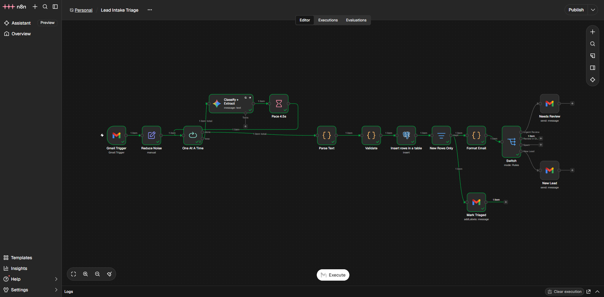
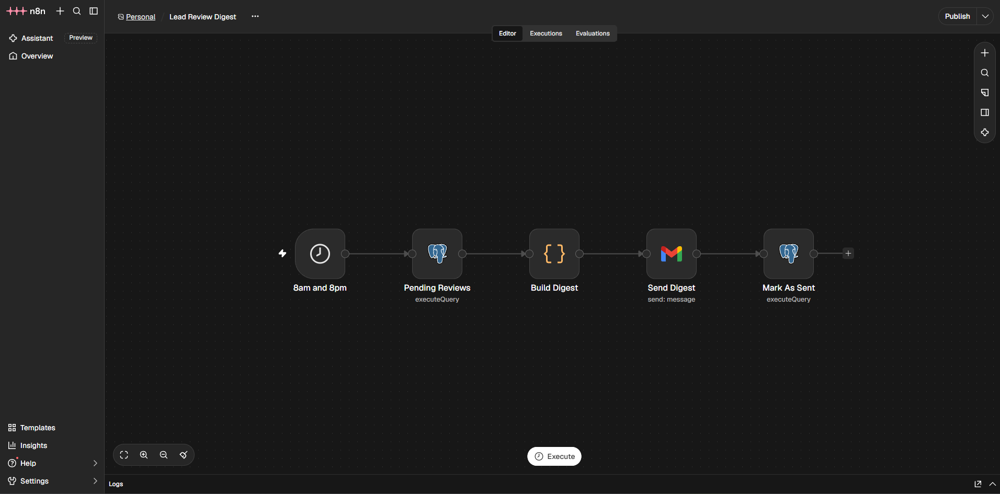
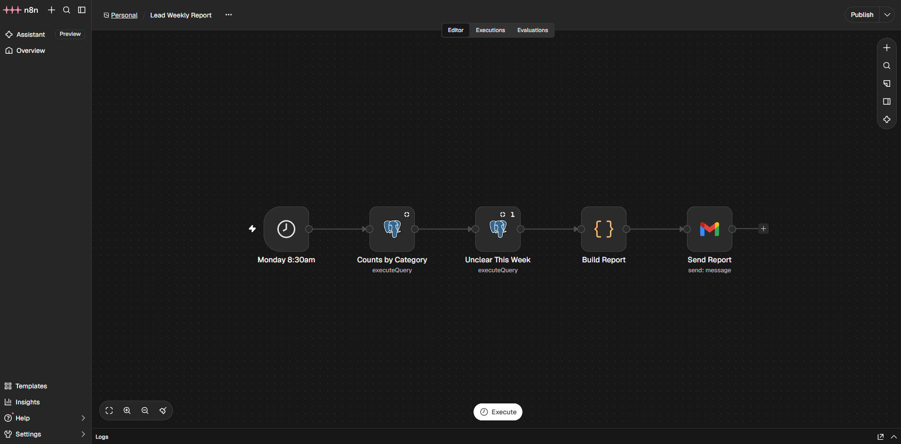

# How it works

One system, four workflows. Only the first one does the real work. The other three report on it or watch it.

| Workflow | Purpose | Runs when |
|---|---|---|
| **Lead Intake Triage** | Reads every new inbox email, classifies it, saves it, alerts you if needed | Every minute |
| **Lead Review Digest** | Sends you one email listing every flagged email that wasn't urgent | 8:00 and 20:00 Manila |
| **Lead Weekly Report** | Sends counts per category and the list of Unclear emails | Mondays 8:30 |
| **Error Alert** | Emails you when any of the three above fails | Only when something breaks |

---

## 1. Lead Intake Triage (the main workflow)

**Flow:** Gmail Trigger → Reduce Noise → One At A Time ⇄ (Classify + Extract → Pace 4.5s) → Parse Text → Validate → Insert rows → New Rows Only → Format Email → Switch → (Needs Review / New Lead) and Mark Triaged

### Nodes

| # | Node | What it does | Why it exists |
|---|---|---|---|
| 1 | **Gmail Trigger** | Every minute, fetches up to 10 emails matching `in:inbox -label:triaged -from:me`, newer than its last check. | Uses a label, not "unread", so an email someone opens before the check is still triaged. `-label:triaged` skips handled mail (dedup layer 1). `-from:me` stops it reading its own notifications. |
| 2 | **Reduce Noise** | Keeps 6 fields: body, subject, sender email, sender name, received time, Gmail message ID. | Small stored data, and one place to change if the source changes (Outlook, a form). The message ID is what dedup depends on. |
| 3 | **One At A Time** | Loop: sends emails to Gemini one by one. When all are done, passes the whole batch to Parse Text. | Gemini's free tier allows 15 calls/minute. Sending a full batch at once would hit the limit. |
| 4 | **Classify + Extract** | Gemini (`gemini-3.1-flash-lite`, temperature 0) returns JSON: category, summary, budget, urgency, deadline, confidence, injection flag. 3 tries, 5 s apart; if all fail it continues and the email goes to review. | The language part. The prompt treats the email as untrusted data, defines the 6 categories and asks for the deadline as a date. |
| 5 | **Pace 4.5s** | Waits 4.5 s after each Gemini call, then loops back. | Keeps calls at about 11/minute. |
| 6 | **Parse Text** | Turns Gemini's text into JSON. Strips code fences, falls back to the first `{...}`. If nothing parses → Unclear with the reason. | Checks format only. Runs once per email, so every email in a poll gets its own result. |
| 7 | **Validate** | Matches each answer to its own email, sets urgency in code, runs 7 guardrails, keeps every reason. | Checks content. Code decides urgency because LLMs count days badly. |
| 8 | **Insert rows in a table** | Saves every email to `leads`. Skip on Conflict on `gmail_message_id`. | Every email leaves a record. The unique key is dedup layer 2, the real guarantee. |
| 9 | **New Rows Only** | Passes only rows that were actually inserted (have an `id`). | When every row is a duplicate, Postgres returns a `{success:true}` placeholder. This keeps it away from the Switch. |
| 10 | **Format Email** | Builds the subject and HTML body for the alert: category and urgency chips, summary, reasons, budget, deadline ("Nov 13, 2026 (in 2 days)"), received time in Manila, an **Open in Gmail and reply** button linked to that exact email, and the original email. Escapes all email text. | One place for the look of both alert emails. Escaping matters because the email is untrusted: a `<script>` or fake link in it shows as text, not HTML. |
| 11 | **Switch** | Routes each row: Urgent Review / Review in Digest / Spam / New Lead. | Only urgent problems interrupt you. |
| 12 | **Needs Review** | Sends the red "🚨 Urgent" HTML email made by Format Email. | Fires only for urgent flagged emails. |
| 13 | **New Lead** | Sends the blue "📩 New lead" HTML email made by Format Email. | The normal good-news path. |
| 14 | **Mark Triaged** | Adds the Gmail label **Triaged** to every newly saved email. | Visible audit trail in the inbox, and what the trigger's filter uses to skip handled mail. |

### How urgency is decided (inside Validate)
1. Email says "no rush", "no hurry", "not urgent", "no fixed deadline" or "just exploring" → **low**.
2. Otherwise, if Gemini found a deadline: 14 days or fewer away (or already past) → **high**, more → **medium**.
3. Otherwise keep Gemini's urgency ("ASAP" with no date stays **high**; nothing about timing → **not_stated**).

### The 7 guardrails (any one sends the email to review)
1. Category isn't one of the 6 → becomes Unclear, Gemini's value recorded.
2. Category is Unclear.
3. Summary or urgency missing, or urgency not one of low/medium/high/not_stated.
4. Gemini says confidence is low.
5. Support/Follow-up: always, because the history it claims can't be verified.
6. Gemini flags a prompt-injection attempt.
7. Spam cross-check (spam phrases, `!!!`, all-caps subject, 3+ links, bulk sender): a lead with 2+ signals, or "spam" with zero signals.

### Where each email ends up

| Scenario | Category | Review? | Route | What you see |
|---|---|---|---|---|
| Clear request: "automate our payroll reminders" | Automation / Reporting / Pricing | No | New Lead | 📩 email now, Triaged label |
| Existing client, urgent: "stopped working, fix ASAP" | Support/Follow-up, high | Yes | Urgent Review | 🚨 email now |
| Existing client, not urgent: "can we move the start date?" | Support/Follow-up | Yes | Review in Digest | Listed in the next 8am/8pm digest |
| Vague: "hello, interested" | Unclear | Yes | Review in Digest | Digest |
| Obvious spam: "You won a gift card!!!" | Spam/Irrelevant | No | Spam | Nothing (row saved, label added) |
| "Spam" with no spam signs (cold pitch, recruiter) | Spam/Irrelevant | Yes | Review in Digest | Digest, so a real lead can't vanish |
| Lead that looks spammy (2+ signals) | Any lead category | Yes | Digest, or Urgent if high | Check before replying |
| Prompt injection: "ignore previous instructions…" | What the sender actually wants | Yes | Digest, or Urgent if high | Flagged with the reason |
| Gemini down or rate-limited after 3 tries | Unclear | Yes | Digest | Digest header says "failed at Gemini, check the quota" |
| Same email seen again (label removed, re-run) | n/a | n/a | Stops at New Rows Only | Nothing (database refused the duplicate) |
| Email you sent yourself | n/a | n/a | Never fetched | Nothing (`-from:me`) |

---

## 2. Lead Review Digest

**Purpose:** batch the non-urgent reviews so you aren't interrupted all day.

| Node | What it does |
|---|---|
| **8am and 8pm** | Schedule trigger (cron `0 8,20 * * *`, Manila time). |
| **Pending Reviews** | SQL: rows with `needs_human_review = 1`, not yet sent (`review_digest_sent_at IS NULL`), and not urgency high (those were already alerted). |
| **Build Digest** | Code: one HTML email with a card per flagged email (chips, subject, sender, summary, why flagged, an **Open in Gmail** link to that email). Warns if any failed at Gemini. Returns nothing when the list is empty, so no email is sent. |
| **Send Digest** | Gmail: sends it. |
| **Mark As Sent** | SQL: stamps `review_digest_sent_at = now()` on those rows so they never repeat. The ids are forced to integers and written into the `IN (...)` list directly. |

**Scenarios:** nothing pending → no email. 3 pending → one email with 3 items. Run twice in a row → the second run sends nothing.

---

## 3. Lead Weekly Report

**Purpose:** see the week at a glance and spot new categories.

| Node | What it does |
|---|---|
| **Monday 8:30am** | Schedule trigger (cron `30 8 * * 1`). |
| **Counts by Category** | SQL: count and number reviewed per category, last 7 days. Test rows (`eval-`, `test-`) excluded. |
| **Unclear This Week** | SQL: every Unclear email from the last 7 days (runs once). |
| **Build Report** | Code: an HTML email with a bar per category (count and how many went to review) plus the Unclear list. Says so if there were no emails at all. |
| **Send Report** | Gmail: sends it. |

**Why the Unclear list matters:** if the same kind of email keeps landing in Unclear (say, "website redesign"), that's a new category to add to the prompt.

---

## 4. Error Alert

**Purpose:** a failure never goes unnoticed.

| Node | What it does |
|---|---|
| **On Workflow Error** | Error Trigger. Fires when the main workflow, the digest or the weekly report fails in a published run (not in manual test runs). |
| **Send Error Alert** | Gmail (HTML): workflow name, failed node, time, the error message, a "What to check" line picked from the error (Gmail login, Gemini quota, timeout, Postgres), and an **Open the failed execution** button. |

**It must stay published.** n8n only lets a published workflow be an error workflow.

**Scenarios that trigger it:**
- **Gmail login expired** (`invalid_grant`): Testing-mode tokens expire every 7 days. Reconnect the Gmail credential in n8n.
- **A run takes over 10 minutes** (the main workflow's time limit), usually Gemini hanging.
- **Postgres down** or a database error.
- Anything else that stops a run.

---

## The five emails you can receive

| Email | Colour | Subject starts with | Button |
|---|---|---|---|
| New lead | Blue | 📩 New lead: category · urgency · name | Open in Gmail and reply |
| Urgent review | Red | 🚨 Urgent: category · name | Open in Gmail and reply |
| Review digest | Grey | 🗂 Review digest: N emails need a look | Open in Gmail, one per email |
| Weekly report | Green | 📊 Weekly report: N emails | none |
| Error alert | Orange | ⚠️ Workflow failed: workflow name | Open the failed execution |

The Open in Gmail links use the Gmail message ID, so they open that exact email in the watched inbox. They go through Google's account chooser, so the right account opens even if you're signed into several.

## Known limits
- **No per-call Gemini timeout.** The whole run is capped at 10 minutes instead. Emails in a run that times out could be skipped, because the trigger's checkpoint has already moved on. Emails that arrive while the workflow is off are not picked up later either. A recovery sweep (inbox mail without the Triaged label, older than an hour) is planned.
- **Free-tier Gemini:** 15 calls/minute and no speed guarantee (calls took from 1 s to over 2 minutes in testing). Use the paid tier for production.
- **More than 10 emails in one minute:** not tested. The overflow may be skipped.
- **Addresses are set per node:** the alert address is in the 5 Gmail send nodes and the watched inbox in 3 Code nodes (`GMAIL_ACCOUNT`). See the README setup steps.
- **Gmail app in Testing mode:** the login expires every 7 days until the app is published.
- **Test set is 49 synthetic emails.**
